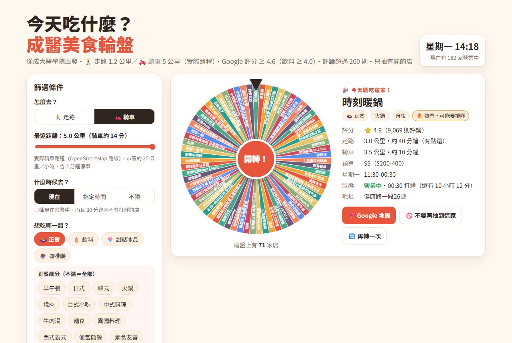

# 成醫美食輪盤

今天吃什麼？從成大醫學院出發，🚶 走路 1.2 公里／🛵 騎車 5 公里（實際路程）內、Google 評分 ≥ 4.6（飲料 ≥ 4.0）、評論超過 200 則的 295 家店，**只抽現在有開的店**。

- 規格書：[SPEC.md](SPEC.md)
- 單一 `index.html`，HTML／CSS／JavaScript 全部寫在同一個檔案；輪盤用 canvas 手刻，不使用任何函式庫。
- 店家資料（2026-10-18／19 整理自 Google 地圖，路程由 OpenStreetMap 計算）：`data/shops_v1.json`、`data/shops_v2_rows.json`；`data/build.py` 合併、分類後產生 `data/shops_raw.json` 並嵌入 index.html。

